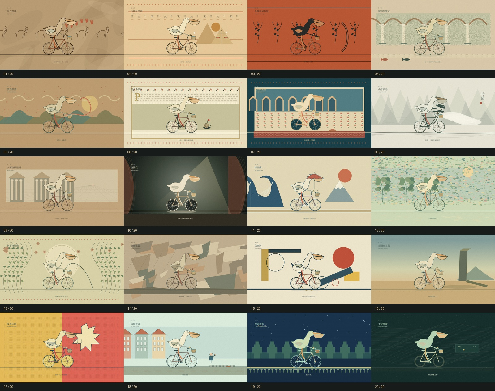

# 鵜鶘測試

一隻認真踩踏的鵜鶘，沿著同一條路穿越二十種藝術語言。

[播放成品影片（MP4）](pelican-test.mp4) · [開啟互動動畫](pelican-test.html)

## 交付檔案

- `pelican-test.mp4`：已完整匯出的影片，1600 × 900、每秒 30 格，包含經音量平衡處理的配樂。
- `pelican-test.html`：可離線播放、跳轉及修改的完整程式動畫。
- `pelican-contact-sheet.jpg`：二十種畫風總覽。
- `pelican-test.webm`：瀏覽器直接匯出的原始影片。

## 開啟方式

直接以 Chrome 或 Edge 開啟 `pelican-test.html`，按下畫面中的播放鍵。無須安裝套件，也不需要連線。

- 片長：2 分 17 秒。
- 畫布：1600 × 900，16:9。
- 所有中文介面、標題與字幕皆為繁體中文。
- 畫面由 Canvas 程式繪製；配樂與車鈴由 Web Audio 合成，無外部圖片或音樂素材。

## 操作

- 空白鍵：播放／暫停。焦點停在按鈕或滑桿時，按鍵維持該元件原本的操作。
- 左右方向鍵：前後跳轉五秒。
- F：進入／離開全螢幕。
- 下方二十個版塊按鈕：直接預覽各種畫風。
- 「聲音：關」：點選開啟配樂；音量可由旁邊滑桿調整。
- 「匯出影片」：從頭錄製畫布與配樂，約需 2 分 17 秒，之後自動下載 WebM。請保持分頁在前景。

影片匯出不包含播放器介面，只包含動畫本身。匯出時會鎖定時間軸與章節跳轉，以維持完整片長。

## 內容與時間

開場 00:00–00:07；二十個藝術版塊各六秒；片尾 02:07–02:17。

洞穴壁畫 → 古埃及壁畫 → 希臘黑繪陶瓶 → 羅馬馬賽克 → 敦煌壁畫 → 泥金手抄本 → 波斯細密畫 → 山水長卷 → 文藝復興透視 → 巴洛克 → 浮世繪 → 印象派 → 新藝術運動 → 立體主義 → 包豪斯 → 超現實主義 → 波普印刷 → 清線漫畫 → 像素藝術 → 生成藝術。

這是一部虛構的藝術穿越短片；古代場景中的自行車是刻意安排的幽默設定。各版塊以程式化視覺語言詮釋畫風。

## 修改

完整樣式、場景、動畫與音樂皆包含在單一 HTML 檔，可用文字編輯器開啟。

- `scenes`：二十站的標題、字幕與配色。
- `landscape`：場景構圖、裝飾與各站的小梗。
- `rider`：鵜鶘、自行車、踩踏動作與畫風變體。
- `draw`：開場、畫框轉場與時間分配。
- `ending`：片尾美術館。
- `melody`、`audioTick`：合成配樂、節奏與車鈴。

程式另提供 `window.pelicanFilm.seek(秒數)`，方便檢視任意時間的畫面。
